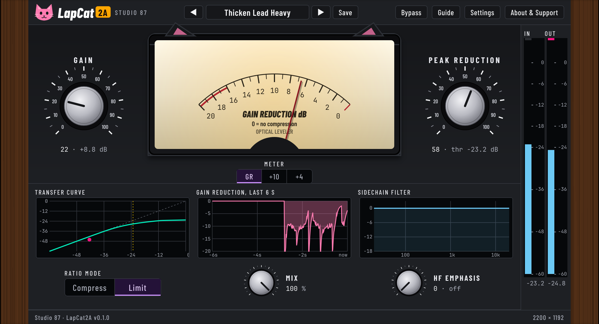

# LapCat2A

A free, open source, cat-themed optical leveling amplifier (VST3), inspired by the classic LA-2A. A behaviour model built from published manuals and measurements, not a circuit simulation. Made to thicken supersaw leads and pads, and good for vocals, bass and buses too.

The real plugin window, drawn offscreen by the compiled editor (not the mockup).

## Status
Test build (pre-release). The VST3 is built by CI for Windows, macOS and Linux; it has not been tried on real Windows, macOS or Linux hosts yet and the sound has not been tuned by ear. See [ROADMAP.md](ROADMAP.md) for what is measured and what is not.

## Download
Get the zip from the [Releases page](https://github.com/SpeakingColors/LapCat2A/releases). One zip holds the Windows installer (.exe), the macOS installer (.pkg), the Linux Flatpak extension and a plain .vst3 tarball, the PDF manual, INSTALL.txt, LICENSE and SHA256SUMS. Everything works offline.

The installers are not signed or notarized (certificates cost money and this plugin is free):
- Windows: if a blue "unknown publisher" screen appears, choose More info, then Run anyway.
- macOS: if the package is blocked, open System Settings, Privacy and Security, then Open Anyway.
- Uninstall: Windows through Settings, Apps; macOS with "Uninstall LapCat2A" in Applications; Linux with `flatpak uninstall --user org.freedesktop.LinuxAudio.Plugins.LapCat2A` or by deleting the .vst3 folder.

## Manual
[LapCat2A-manual.pdf](docs/LapCat2A-manual.pdf) has an interface tour, every control, the factory presets and what was measured.

## Controls
Gain, Peak Reduction, Mix, HF Emphasis, Ratio mode (Compress or Limit), Meter (GR, +10, +4), Bypass, presets (20 factory presets, your own presets, export and import). Every control has a hover info bubble (can be switched off), every meter has a dB scale, three colour looks, and the window resizes from every edge and corner. Keys: B bypass, C ratio mode, M meter.

## Build from source
`sh tests/run.sh` runs the core tests without JUCE. `cmake -S . -B build && cmake --build build` builds the VST3 (JUCE 8.0.16 is fetched by CMake). Layout.h is generated from the approved mockup (`tools/dump_layout.py`, `tools/gen_layout.py`). The interactive mockup stays in `docs/mockup/`.

## Privacy
Collects nothing. No network access, ever. The Ko-fi and GitHub buttons only open your browser when you click them.

## Support

  

Free and open source, made by one person. If it helps your music, a coffee on [Ko-fi](https://ko-fi.com/studio87) keeps it coming.

## License
AGPL-3.0-or-later, see [LICENSE](LICENSE). Built with JUCE under the AGPLv3 option.
